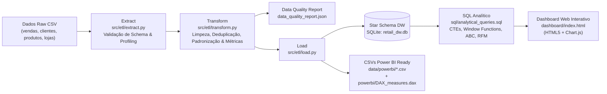
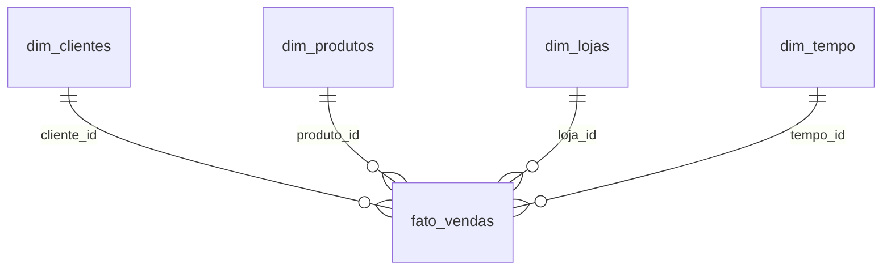

# RetailPulse — Pipeline ETL, Modelagem Star Schema & Dashboard Analítico

Pipeline de Engenharia de Dados e Business Intelligence ponta a ponta em **Python + SQL + Power BI Ready**, projetado para transformar exportações brutas e inconsistentes de varejo em um **Data Warehouse dimensional (Star Schema)** auditado, pronto para consultas analíticas avançadas, Power BI Desktop e visualização executiva na web.

---

## 🎯 Problema de Negócio Resolvido

Em operações reais de varejo omnichannel (lojas físicas, e-commerce, app mobile e marketplaces), os dados chegam de múltiplos ERPs e planilhas com problemas crônicos:
- Registros duplicados de vendas, clientes e produtos;
- Datas em múltiplos formatos (`YYYY-MM-DD`, `DD/MM/YYYY`, `DD-MM-YYYY`, `YYYY/MM/DD`) e datas inválidas;
- Valores monetários inconsistentes (`R$ 1.299,90`, `1299.90`, `450,00`), quantidades negativas ou preços zerados;
- Estados (`sp`, `São Paulo`, `sao paulo`) e categorias (`ELETRO`, `eletronicos`, `Casa e Decoracao`) sem padronização;
- Chaves estrangeiras ausentes ou órfãs quebrando relatórios gerenciais.

O **RetailPulse** automatiza toda a ingestão, limpeza, validação de qualidade, modelagem dimensional e geração de KPIs executivos com **zero dependências externas** (100% Python 3.12 Standard Library).

---

## 🏗️ Arquitetura do Pipeline



---

## ⭐ Modelagem Dimensional (Star Schema)

O Data Warehouse (`data/warehouse/retail_dw.db`) e os CSVs analíticos (`data/powerbi/`) seguem o modelo estrela com integridade referencial ativa (`PRAGMA foreign_keys = ON`) e índices otimizados para agregações OLAP:

| Tabela | Tipo | Chave Primária | Descrição |
| :--- | :--- | :--- | :--- |
| **`fato_vendas`** | Fato | `venda_id` | Transações válidas com métricas financeiras (`valor_bruto`, `valor_desconto`, `receita_liquida`, `custo_total`, `lucro_bruto`, `margem_bruta_pct`), canal e forma de pagamento. |
| **`dim_clientes`** | Dimensão | `cliente_id` | Cadastro padronizado de clientes com cidade, UF, estado, região do Brasil, segmento e data de cadastro. |
| **`dim_produtos`** | Dimensão | `produto_id` | Catálogo de produtos com categoria canônica, marca, preço de lista e custo unitário. |
| **`dim_lojas`** | Dimensão | `loja_id` | Unidades físicas e canais digitais com localização padronizada e canal padrão. |
| **`dim_tempo`** | Dimensão | `tempo_id` (`YYYYMMDD`) | Calendário analítico com ano, trimestre (`T1`–`T4`), mês, nome do mês em PT-BR, `ano_mes`, dia da semana e indicador de fim de semana. |



---

## 📊 Consultas SQL Analíticas (`sql/analytical_queries.sql`)

Compatíveis com **SQLite 3.25+** e **MySQL 8.0+**, utilizando CTEs e Window Functions (`LAG`, `SUM() OVER`, `RANK`, `NTILE`):
- **KPIs Executivos (`kpi_overview`)**: Receita Líquida, Lucro Bruto, Margem Bruta %, Ticket Médio, Pedidos Válidos, Clientes Ativos e Desconto Médio.
- **Série Temporal MoM & YoY (`monthly_revenue_growth`)**: Evolução mensal de receita com variação mês contra mês (`LAG(..., 1)`) e ano contra ano (`LAG(..., 12)`).
- **Performance por Categoria e Região (`category_performance`, `regional_performance`)**: Ranking, margem e participação percentual sobre o total.
- **Curva ABC / Pareto (`abc_curve_products`)**: Classificação automática de produtos em **Classe A (≤ 80%)**, **Classe B (≤ 95%)** e **Classe C (> 95%)** da receita acumulada.
- **Segmentação RFM (`rfm_segmentation`)**: Classificação de clientes por Recência, Frequência e Valor Monetário usando `NTILE(4)` (*Campeões*, *Clientes Fiéis*, *Potencial de Crescimento*, *Em Risco*, *Hibernando*).
- **Top 10 Clientes (`top_customers`)** e **Mix de Canais (`channel_performance`)**.

---

## 📈 Integração com Power BI & Medidas DAX

Todos os arquivos em `data/powerbi/` são exportados em **UTF-8 com BOM (`utf-8-sig`)** para reconhecimento imediato de acentuação no Power BI Desktop (Windows).

### Passo a passo no Power BI Desktop
1. Clique em **Obter Dados → Texto/CSV** e importe as 5 tabelas de `data/powerbi/`:
   - `fato_vendas.csv`, `dim_clientes.csv`, `dim_produtos.csv`, `dim_lojas.csv`, `dim_tempo.csv`.
2. Na aba **Exibição de Modelo**, confirme os relacionamentos `1:N` (direção única) das dimensões para `fato_vendas`.
3. Marque `dim_tempo` como **Tabela de Datas** usando a coluna `dim_tempo[data]`.
4. Crie uma tabela de medidas e cole as fórmulas documentadas em [`powerbi/DAX_measures.dax`](powerbi/DAX_measures.dax):

| Medida DAX | Objetivo |
| :--- | :--- |
| **`Receita Total`** | Soma da receita líquida (`SUM(fato_vendas[receita_liquida])`). |
| **`Lucro Bruto`** | Soma do lucro bruto (`SUM(fato_vendas[lucro_bruto])`). |
| **`Margem Bruta %`** | Rentabilidade percentual (`DIVIDE([Lucro Bruto], [Receita Total], 0)`). |
| **`Ticket Médio`** | Valor médio por pedido (`DIVIDE([Receita Total], [Total de Pedidos], 0)`). |
| **`Crescimento MoM %`** | Variação mensal usando `DATEADD(dim_tempo[data], -1, MONTH)`. |
| **`Crescimento YoY %`** | Variação anual usando `SAMEPERIODLASTYEAR(dim_tempo[data])`. |
| **`Top Clientes`** | Receita concentrada nos Top 10 clientes via `TOPN` + `ALLSELECTED`. |

---

## 🚀 Como Executar

### Pré-requisitos
- **Python 3.10+** (nenhum pacote externo obrigatório).

### 1. Executar o pipeline completo ponta a ponta
```bash
python main.py
```
O comando executa automaticamente:
1. Geração dos CSVs brutos com anomalias realistas em `data/raw/`;
2. Extração e profiling inicial (`src/etl/extract.py`);
3. Limpeza, deduplicação, padronização e relatório de qualidade (`data/warehouse/data_quality_report.json`);
4. Carga do Star Schema no SQLite (`data/warehouse/retail_dw.db`) e exportação dos CSVs em `data/powerbi/`;
5. Execução das consultas SQL analíticas e atualização de `dashboard/data.json` e `dashboard/dashboard_data.js`.

Opções de CLI disponíveis:
```bash
python main.py --sales 3000 --seed 42
python main.py --skip-generate
```

### 2. Abrir o Dashboard Analítico Interativo
Basta abrir o arquivo abaixo diretamente no navegador (funciona via `file://` sem necessidade de servidor HTTP ou problemas de CORS):
```text
dashboard/index.html
```

### 3. Executar a suíte de testes automatizados
```bash
python -m unittest discover -s tests -v
```

---

## 📁 Estrutura do Projeto

```text
sales-bi-etl-pipeline/
├── main.py                         # CLI única para executar todo o pipeline ponta a ponta
├── requirements.txt                # Zero dependências obrigatórias (Python Stdlib)
├── src/
│   ├── config.py                   # Caminhos, dicionários de padronização (UF, categorias, canais)
│   ├── generate_raw_data.py        # Gerador de CSVs brutos com defeitos realistas de qualidade
│   ├── run_analytics.py            # Executor das queries SQL + exportação para o Dashboard
│   └── etl/
│       ├── extract.py              # Leitura de CSVs raw e profiling de qualidade
│       ├── transform.py            # Limpeza, deduplicação, métricas e data_quality_report.json
│       └── load.py                 # Carga no Star Schema SQLite e CSVs Power BI Ready
├── sql/
│   ├── schema.sql                  # DDL do Star Schema + índices analíticos
│   └── analytical_queries.sql      # Queries SQL (CTEs, Window Functions, MoM/YoY, ABC, RFM)
├── powerbi/
│   └── DAX_measures.dax            # Medidas DAX prontas e documentadas para Power BI
├── dashboard/
│   ├── index.html                  # Dashboard executivo interativo (HTML5 + Chart.js)
│   ├── data.json                   # Saída analítica estruturada em JSON
│   └── dashboard_data.js           # Payload embarcado para abertura direta via file://
├── data/
│   ├── raw/                        # CSVs brutos gerados
│   ├── warehouse/                  # retail_dw.db + data_quality_report.json
│   └── powerbi/                    # Tabelas limpas prontas para o Power BI Desktop
└── tests/
    ├── test_transform.py           # Testes de limpeza, padronização, deduplicação e KPIs
    ├── test_star_schema.py         # Testes de integridade referencial SQLite e CSVs Power BI
    └── test_analytics.py           # Testes das queries SQL (MoM, ABC, RFM) e artefatos do dashboard
```

---

## 👤 Autor

Desenvolvido por **Carlos Emanuel** como parte do portfólio de Engenharia de Dados e Business Intelligence.
